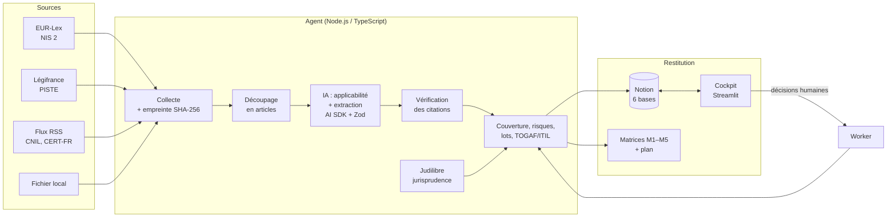

# Comment fonctionne l'agent

Ce document explique le fonctionnement de l'agent, de façon à ce que chaque membre de l'équipe puisse le présenter à l'oral.

## Vue d'ensemble

## Les étapes, une par une

### 1. Collecte (`agent/src/sources/`)
Chaque connecteur renvoie les documents dans le même format (`DocumentRecupere`) :
- **EUR-Lex :** télécharge la page HTML officielle à partir du numéro CELEX (NIS 2 = `32022L2555`) et en garde une copie dans `data/sources/`.
- **Légifrance :** recherche via l'API PISTE (authentification OAuth2 *client credentials*), utile pour suivre la transposition française.
- **RSS :** CNIL, CERT-FR (ANSSI), dossiers législatifs, avec un filtre par mots-clés.
- **Fichier local :** un texte officiel téléchargé au préalable, comme le TP l'autorise.

Les textes complets sont analysés. Les actualités deviennent des **signaux** du fil de veille.

### 2. Détection des modifications et déduplication (`state.ts`)
On calcule une **empreinte SHA-256** du contenu normalisé, et on la compare à celle enregistrée dans `data/etat-veille.json` :
- empreinte inconnue → document **nouveau** ;
- empreinte différente pour le même identifiant → document **modifié** : sa version augmente et ses exigences repassent « À valider » ;
- empreinte identique à celle d'un autre document → **doublon**, ignoré.

### 3. Découpage en articles (`parse.ts`)
Le texte est découpé sur les lignes « Article N ». On envoie au modèle **un article à la fois**. Les réponses sont plus précises, et chaque exigence garde la trace de son article.

### 4. Analyse par l'IA (`llm.ts`, `schemas.ts`)
On utilise l'**AI SDK** de Vercel avec la fonction `generateObject` et un **schéma Zod**. Le modèle ne répond pas en texte libre : il doit remplir une structure précise, et toute réponse mal formée est rejetée puis redemandée. Pour chaque exigence, il fournit :

| Champ | Exemple |
|---|---|
| `article` | Art. 23 §4 a) |
| `obligation` | Envoyer une alerte précoce au CSIRT dans les 24 heures… |
| `citation` | extrait **mot pour mot** du texte |
| `destinataire` | Entités essentielles et importantes |
| `echeance` / `sanction` | 24 heures / amende jusqu'à 10 M€ ou 2 % du CA |
| `applicable` + justification | oui, car Hydréa est une entité essentielle |
| `confiance` | 0,96 |

Le *prompt système* impose de ne rien inventer et de citer le texte mot pour mot.

### 5. Vérification (`verify.ts`)
C'est l'exigence clé du TP : *toutes les obligations doivent être vérifiables dans les sources officielles.*
- Si la citation est retrouvée **mot pour mot** dans le texte, l'exigence est vérifiée.
- Si au moins 85 % de ses mots sont retrouvés, elle est « proche », et la confiance baisse un peu.
- Sinon, elle est **à contrôler** : la confiance est fortement réduite et l'exigence est mise en avant dans le cockpit.
- On vérifie aussi que l'article cité correspond à l'article analysé.

Dans la démo, `REQ-NIS2-023-02` montre ce mécanisme : le modèle a reformulé au lieu de citer, et l'agent le détecte.

### 6. Matrices GRC (`matrices.ts`)
Les calculs sont **déterministes**, donc explicables : l'IA extrait, les règles calculent, l'humain valide. Les 5 matrices partagent le même identifiant `REQ-…`.

- **Thèmes communs.** Chaque exigence porte 1 à 4 thèmes (gestion des incidents, notification, chaîne d'approvisionnement…). Les processus, systèmes, données, contrats et contrôles d'Hydréa portent les mêmes thèmes, ce qui permet de les relier.
- **M2 Impact :** les éléments de l'organisation qui partagent un thème avec l'exigence.
- **M3 Couverture :** la moyenne, sur les thèmes de l'exigence, de la meilleure maturité des contrôles existants (de 0 à 5), divisée par 5. Une exigence est « couverte » à partir de 0,6, « partielle » à partir de 0,3, « non couverte » en dessous.
- **M4 Risque :** le risque inhérent vaut probabilité × impact (de 1 à 25). L'impact correspond à la criticité des processus touchés, avec un plancher pour la gouvernance et la formation. Le risque résiduel vaut inhérent × (1 − 0,8 × couverture).
- **Lots d'action :** les écarts sont regroupés par thème. Un lot est P1 si son risque résiduel atteint 15 ou s'il concerne la notification, avec une échéance à 3 mois. Il est P2 à 6 mois et P3 à 12 mois.
- **M5 Jurisprudence :** pour chaque exigence, une requête Judilibre est préparée, puis exécutée si les identifiants PISTE sont configurés.

### 7. Gouvernance (`gouvernance.ts`)
Chaque thème est rattaché à **TOGAF** (architecture : gouvernance, risques, fournisseurs, actifs) ou à **ITIL** (exploitation : incidents, continuité, accès). On calcule la part de chaque cadre, puis l'IA rédige une recommandation argumentée. **La décision finale est saisie par un humain** dans le cockpit.

### 8. Stockage et validation (`storage/`, `cockpit/`, `worker.ts`)
- **Notion :** 6 bases reliées (Textes, Exigences, Contrôles, Risques, Jurisprudence, Lots d'action). Le titre de chaque page est son identifiant, ce qui permet de la **mettre à jour** au lieu de la dupliquer.
- **Cockpit :** il affiche la citation, le résultat de la vérification et la confiance. L'humain **valide**, **corrige** (en modifiant l'obligation) ou **rejette** (avec une justification obligatoire).
- **Worker :** il récupère ces décisions dans Notion, recalcule les risques, les lots et les matrices, puis met Notion à jour.

### 9. Assistant : chatbot et dépôt de document (`cockpit/assistant.py`)
- **Dépôt de document :** l'utilisateur dépose un PDF, une page HTML ou un fichier texte dans le cockpit. Un PDF est converti en texte avec `pypdf`. L'agent lance ensuite la même chaîne que `npm run analyse` (étapes 3 à 7) et les onglets se mettent à jour. Un document sans « Article N » (guide, recommandation) est découpé en sections.
- **Chatbot (approche RAG).** À chaque question :
  1. on **retrouve** les exigences les plus proches (mots communs, article ou identifiant cité, synonymes comme « urgent » → critique) ;
  2. on les envoie au modèle avec la synthèse (risques, lots, gouvernance) ;
  3. le modèle **rédige** une réponse qui cite les identifiants REQ-… et les articles.

  La réponse s'affiche **en direct**, mot par mot (streaming). Le modèle n'a accès qu'aux résultats de l'agent, ce qui limite les inventions. En mode démo, le chatbot liste simplement les exigences pertinentes, sans IA.

## Pourquoi ces choix techniques ?

| Choix | Raison |
|---|---|
| AI SDK + Zod | Sorties structurées et validées, et changement de fournisseur (Gemini, Mistral) en une ligne |
| Gemini / Mistral gratuits | Projet sans budget |
| Mode démo (`mock`) | Démonstration fiable sans réseau ni clé, et tests reproductibles |
| Calculs déterministes après l'IA | Résultats explicables et auditables, sans « boîte noire » |
| Vérification des citations | L'IA peut halluciner, donc tout doit être recoupé avec le texte officiel |
| Notion | Base partagée par l'équipe, lisible sans outil technique |
| Chatbot RAG avec streaming | Réponses immédiates et fondées sur les exigences vérifiées, pas sur la mémoire du modèle |
